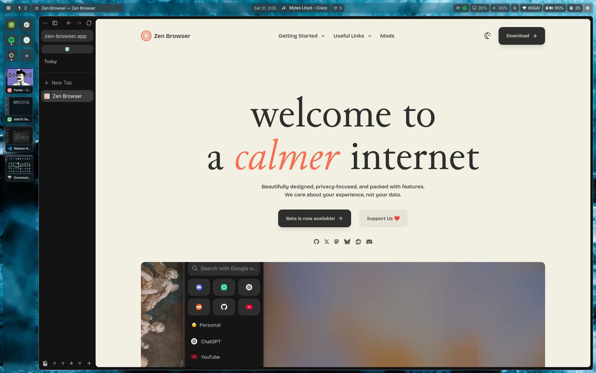

<div align="center">

# bbkOS dots

**A wallpaper-themed Hyprland + Quickshell desktop for Arch Linux.**
One installer that looks at your hardware, a settings app, an agent skill, and an uninstaller that puts everything back.


</div>

Colours come from the wallpaper. Every look and behaviour setting (bar, gaps, radii, blur, fonts, lock screen, keybinds, touchpad, power) is one value in one JSON file, edited from a settings window or the `bbkos-theme` command. Built on Hyprland's new **Lua config** (0.55+), Quickshell, matugen and uwsm.

| **Grid mode** (the default look): one-pixel cells, the rail with pinned apps hugging the bottom edge | **Without grid mode**: the same desktop with a floating bar and the rail on the left |
|---|---|
|  |  |
| **Settings app** (`Super+,`): 17 pages, search, reset per page | **Launcher** (`Super+R`): apps, commands and every single setting |
|  |  |
| **Bar popups**: battery and sound (calendar, Wi-Fi, Bluetooth, display and timer too) | **Tiling** with kitty, fish and starship |
|  |  |

## Design choices

The parts that set this desktop apart. Each one is a switch you can turn off.

- **Grid mode.** One toggle (Settings > bbkOS > Grid mode) turns the desktop into flat cells with one-pixel borders: the bar's widgets and the rail are touching cells, a single line runs along all four screen edges, and popups have no shadows or rounded corners (they can keep their round corners). Windows keep your own margin and corner radius, so each one sits as a rounded card inside the grid. Every line lands on a whole screen pixel, also at fractional scales. Inspired by the key grid of my Android keyboard, [Omakey](https://github.com/thehumanx/omakey). On in the default look.
- **Stage mode.** A workspace opens windows one at a time, full size, and the others wait as thumbnail cards in a rail at the edge; click a card to bring it forward. Inspired by macOS Stage Manager. It works *per workspace*: the default is a setting, the switch at the end of the rail (tiled or stage, side by side), `Super+Alt+S` or the menu flips one workspace, and the rail's size, position and look are on Settings > bbkOS. On in the default look.
- **Rail and pinned apps.** The rail also holds your pinned apps: click a tile to bring the app forward or start it, `+` to pin one from the menu, hover and `×` to unpin; a dot shows which ones are running; the cards of open windows show the app icon in the middle. Put the rail on any screen edge, along its whole length or only as long as its contents, and align it (and its tiles and cards) to the start, centre or end; on the top or bottom it is a single row. Outside grid mode it follows the bar's look: background, blur, rounded corners, floating and pill style. Pinned apps are on in grid mode and a switch of their own otherwise.
- **Settings app for the details.** `Super+,` opens a real window with 17 pages in five groups (the first, bbkOS, gathers what is particular to this desktop: grid mode, the rail and pinned apps, stage mode) and a search box that finds any single setting, with "Reset these" per section and a reset for the page you are on. If the look, behaviour or hardware can be changed, it is in there; nothing is hidden in a file you have to know about.
- **Global menu.** `Super+R` is one search box for apps, web apps, commands, settings pages *and single settings*, plus a calculator and a web search; it ranks like Raycast and learns what you open. Inspired by typecraft's Raycast-style launcher for Linux ([oma-cast](https://github.com/typecraft-dev/oma-cast)); the ranking follows the behaviour its spec documents, the code is written from scratch.
- **Notification panel.** The shell is the notification daemon, so history is part of the desktop: the bell in the bar shows the unread count and opens a sheet down the right edge. Read state is manual (a click marks one read, "Mark all read", two-click "Clear all"), a right click closes a popup without triggering its action, and there is a do-not-disturb switch, per-app mute and a critical-urgency style. Short state notices (charger, sound output, VPN) are small toasts that never enter the history.
- **Bar popups.** Battery, sound, Wi-Fi, Bluetooth, display, calendar and timer open as small cards under the widget you clicked, in the same look as the settings window, and keep the windows' margin from the screen edge, so they line up with your windows (notifications too). Inspired by Omarchy's widget popups.
- **Privacy indicator.** A warning-coloured glyph appears in the bar only while an app is using the microphone, the camera or a screen share, and takes no space the rest of the time. It reads PipeWire's streams and, for the camera, also notices programs that open `/dev/video*` themselves (Vivaldi, Electron apps, most call clients), which PipeWire never sees. Each of the three can be switched off in Settings > Privacy and wellbeing, and the page lists which app is using what right now. Inspired by the indicators in GNOME, COSMIC and DankMaterialShell.

## What is in it

- **Shell:** bar, launcher, notifications, lock screen (hyprlock), OSDs, clipboard history with preview, emoji picker, screen recorder, webcam controls, calendar and timer. All QML in `dotfiles/quickshell`.
- **Theme engine:** `bbkos-theme` turns the wallpaper into colours for the shell, kitty, GTK 3/4, hyprlock and Hyprland; every text colour is lifted until it passes WCAG contrast on the surface it is drawn on.
- **Display handling:** per-monitor scale, mode and layout, DDC/CI brightness for external monitors, a night-light schedule.
- **Laptop:** battery and power-profile popups, lid actions, optional root helpers for power limits, charge mode and a touchpad stall fix.
- **Extras (opt in):** local dictation (Voxtype), Android app manager, screen sharing over VNC, btrfs snapshots.
- **Agent skill:** `.claude/skills/bbkos` plus `AGENTS.md`, so Claude Code (or any agent) can change the desktop without breaking it. See [Using an agent](#using-an-agent).

## Settings at a glance

`Super+,` opens the settings window: 17 pages in five groups, 236 searchable rows. Every value lives in `~/.config/bbkos/settings.json`; `bbkos-theme set section.key value` changes the same thing from a terminal.

| Group | Page (tabs) | What you can change |
|---|---|---|
| **bbkOS** | **bbkOS** (Grid mode, Rail and pinned apps, Stage mode) | grid mode and round controls; pinned apps, the rail's edge, thickness, hugging, alignment, padding; stage mode default and the window cards |
| **Look** | **Appearance** (Wallpaper and colours, Style, Terminal) | wallpaper picker; dark or light, or switch by time of day; colour scheme (9 styles), contrast, accent strength; font, text size, radii, gaps, popup shadow, reduced motion; kitty font, padding and opacity |
| | **Bar** (Layout, Look, Widgets) | position (any edge), thickness, floating, hugging, widget order by drag, switch any widget off; opacity, blur, pills, icon style; clock format, hover date, calendar week start, week numbers and moon, music widget width |
| | **Windows** (Look, Behaviour) | gaps, border, rounding, opacity, shadow, blur, animation speed; focus follows mouse, workspace switching |
| | **Lock screen** | avatar picture, position and size of every element (clock, date, welcome text, password field, battery), blur, brightness with auto-dim, 12/24 h |
| **Desktop** | **Notifications** | do not disturb, popup timeout and corner, history size, per-app mute, critical style |
| | **Apps** (Default apps, Startup, Launcher) | default browser, terminal, files, media; apps that start at login; menu web-search engine, calculator, forget what it learned |
| | **Capture and camera** | screenshot folder and editor; recording area, audio, quality and folder; webcam exposure, white balance, power-line frequency |
| | **Privacy and wellbeing** | mic, camera and screen-sharing indicators; clipboard history (text and images); screen time and break reminders |
| **Devices** | **Network** | Wi-Fi, saved connections, Tailscale, screen mirroring to a phone |
| | **Displays** | per-monitor scale, resolution, layout, brightness (DDC/CI for external ones), night-light schedule |
| | **Sound** | outputs, inputs, volume, per-app volume |
| | **Power and sleep** (When idle, Lid and power button, Power profiles) | idle dim, lock and sleep timers, keep-awake; lid and power-button actions; profile tuning (CPU energy preference, turbo, power cap, battery charge mode) with the root helper |
| | **Keyboard** (Typing, Shortcuts, Dictation) | layout, repeat rate; rebind any shortcut; dictation status (service, backend, model, language; read-only) |
| | **Mouse and touchpad** (Mouse and cursor, Touchpad, Gestures) | speed, acceleration, natural scrolling, cursor theme and size; tap, scroll, disable while typing; what three- and four-finger swipes do |
| **System** | **Accessibility** | reduced motion, contrast, larger text and cursor, slow keys |
| | **About and system** (About and updates, Reset) | system info and update check; reset a section, a page or everything |

Anything not in the window is a plain key in the JSON file; `bbkos-theme defaults` prints them all with their defaults.

## Bar widgets at a glance

Sixteen widgets, placed in the start, centre and end of the bar. Reorder them by dragging in Settings > Bar > Layout, where the switch at the start of each row takes a widget off the bar (it keeps its place for when you switch it back on); the icon sets and "icons only" are in Bar > Look. Widgets marked *when* hide themselves the rest of the time.

| Widget | Shows | Click · scroll · hover | Shown |
|---|---|---|---|
| **Workspaces** | one number per workspace | click activates | always |
| **Window title** | the focused window's icon and title, in a fixed-width cell | none | horizontal bars |
| **Clock** | day, date and time (`Sun 25, 5:26`) | click opens the calendar; hover shows the full date | always |
| **Music** | title of the song playing, any MPRIS player | click opens the player's app, middle click skips, scroll sets the volume; hover shows previous, play or pause, next | *when* a song plays or is paused (horizontal bars) |
| **Timer** | countdown, dim when paused, flashing red when done | click opens the timer popup: pause, +1 min, +5 min, reset | *when* a timer runs |
| **Updates** | icon and the number of pending repo updates | click opens a terminal running `bbkos-update` | *when* updates are pending |
| **Tray** | one icon per app that registers (black icons are recoloured to stay visible) | left click activates, middle click secondary, right click the app's menu | *when* an app registers an icon |
| **Display** | monitor icon and this monitor's brightness | click opens the display popup; scroll changes brightness by 5 % | always |
| **Audio** | speaker icon and volume | click opens the sound popup, middle click mutes, scroll changes volume by 5 % | always |
| **Bluetooth** | icon by state: off, connected (accent), idle | click opens the Bluetooth popup | *when* an adapter exists |
| **Network** | Wi-Fi name with signal bars, wired globe, or `off`, `connecting…`, `offline` | click opens the Wi-Fi popup | always |
| **Battery** | icon and charge, warn and crit colours when low | click opens the battery and power-profile popup | *when* a battery exists |
| **Notifications** | bell and unread count (`99+` above 99) | click opens the history sheet | always |
| **Recording** | red dot and elapsed time | click stops and saves | *when* recording |
| **Privacy** | amber glyphs for microphone, camera, screen share | none | *when* an app uses one |
| **Settings** | gear, accent while the window is open | click opens or closes the settings window | always |

While a widget's popup is open it gets a highlighted plate. The popup opens under the widget you clicked, on any bar edge. Details and how to add a widget: `docs/modules/bar.md`.

## Install

Requirements: Arch Linux (or a derivative with the same repos), a normal user with `sudo`, and **Hyprland 0.55 or newer** (the config is Lua; the installer refuses to continue otherwise). Works best on a fresh install with a Wayland session you can log into from a TTY or display manager.

```sh
sudo pacman -S --needed git stow
git clone https://github.com/thehumanx/bbkos-dots.git
cd bbkos-dots
./install.sh --detect      # what it found, and the packages it would install. Changes nothing.
./install.sh               # asks a few questions, then does it
```


Keep the checkout where it is: the config files are symlinks into it.

### What the installer does

1. **Detects hardware** (see below) and builds a package list from `packages/*.txt`. Official repos only unless you opt in to dictation. Packages already installed are not touched.
2. Runs `sudo pacman -S --needed …` once, showing the list. Nothing is installed silently.
3. **Moves any file in the way** to `~/.local/share/bbkos/backup/<time>/`, then links the dotfiles with Stow. Nothing is overwritten.
4. Renders the two files that hold absolute paths (`hyprlock.conf`, `gtk-4.0/gtk.css`), copies `defaults/settings.json` to `~/.config/bbkos/` if you have none, sets the default wallpaper and generates the theme.
5. Enables the user services (`quickshell`, `cliphist`, `hypridle`, `bbkos-camera`), and asks before enabling `NetworkManager`, `bluetooth` and `power-profiles-daemon` or installing root helpers.
6. Builds [omasnap](https://github.com/omacom/omasnap) (screenshots, OCR, annotation) from source at a pinned commit.

### Hardware detection

| Detected | Installed |
|---|---|
| CPU Intel / AMD | `intel-ucode` / `amd-ucode` |
| GPU Intel / AMD / NVIDIA | `mesa` + `vulkan-intel` + `intel-media-driver` / `vulkan-radeon` / `nvidia-open-dkms` + `nvidia-utils` (older NVIDIA cards: edit `packages/hw-nvidia-gpu.txt`) |
| Intel HD audio controller | `sof-firmware` |
| Battery (laptop) | `powertop`; offers the power and lid helpers and `power-profiles-daemon` |
| No Bluetooth / no Wi-Fi | drops `bluez*`, `bluetui` / `iw` |
| I2C touchpad | offers the touchpad stall fix |
| btrfs root | `btrfs-progs`; offers snapper snapshots |
| Intel Core Ultra (Meteor Lake and newer) | offers `intel-lpmd` |
| `tlp` or `auto-cpufreq` enabled | skips `power-profiles-daemon` (they conflict) |
| `iwd` or `systemd-networkd` running | leaves your network stack alone (the Wi-Fi panel needs NetworkManager) |

### Options

```
./install.sh [--detect] [--dry-run] [-y] [--with LIST] [--no-extras] [--no-packages]
             [--no-omasnap] [--no-services] [--no-system]
--with   dictation,android,remote,snapshots,lpmd,touchpad,all
```

`--dry-run` runs every step and prints the `sudo` commands instead of running them. `--no-system` touches nothing outside `$HOME` except `pacman`.

### First login

No display manager is configured for you. From a TTY, after logging in:

```sh
uwsm start hyprland-uwsm.desktop
```

(or pick *Hyprland (uwsm-managed)* in your display manager; `docs/modules/session.md` shows a greetd autologin setup). Then `Super+,` for the settings and `bbkos-check` for a health check.

## Keys

| | Keys |
|---|---|
| **Apps** | `Super+Q` terminal · `Super+E` files · `Super+R` launcher · `Super+,` settings · `Super+L` system menu |
| **Windows** | `Super+C` close · `Super+V` float · `Super+F` fullscreen · `Alt+Tab` cycle · `Super+Alt+S` stage mode |
| **Workspaces** | `Super+1…0` go to · `Super+Shift+1…0` move the window there · `Super+S` scratch workspace |
| **Capture** | `Super+Shift+S` screenshot · `Super+Shift+T` copy text from the screen (OCR) · `Super+Shift+R` record menu |
| **Tools** | `Super+Ctrl+V` clipboard history · `Super+;` emoji · `Super+Ctrl+X` dictation (opt-in) |
| **Session** | `Super+Ctrl+L` lock · `Super+Shift+Space` hide the bar |

All of them are editable in Settings > Keyboard > Shortcuts, or `bbkos-keybinds`.

## Customise

| Do this | With |
|---|---|
| Look: colours, bar, gaps, radii, blur, fonts, lock screen | `Super+,` or `bbkos-theme set shell.barHeight 36` · `bbkos-theme status` |
| Wallpaper (colours follow it) | Settings > Appearance, `bbkos-theme wallpaper set FILE`, or right-click an image in Thunar |
| Keybindings | `bbkos-keybinds` (never edit the generated file) |
| Monitors | `bbkos-display` or the Display popup |
| Anything Hyprland-specific | `~/.config/hypr/hyprland.lua` is a symlink into this repo: edit it there, keep your changes on a branch |
| Go back to defaults | `bbkos-theme reset` (everything) or `reset SECTION` |

Your settings live in `~/.config/bbkos/settings.json`, a copy that the settings app writes to. `git pull` never touches it.

## Update

```sh
git pull && ./install.sh --no-packages    # re-link, re-render, regenerate the theme
```

What changed in each update: [CHANGELOG.md](CHANGELOG.md).

## Uninstall

```sh
./uninstall.sh                # unlink, remove rendered files, disable user services, restore the files it moved aside
./uninstall.sh --system       # also remove the root helpers and the system services it enabled
./uninstall.sh --packages     # also pacman -Rns the packages install.sh added (not those you already had)
./uninstall.sh --purge        # also delete ~/.config/bbkos, ~/.local/state/bbkos and the backups
```

`--dry-run` shows what would happen. Your own settings stay unless you pass `--purge`.

## Using an agent

The repo ships an agent skill. In Claude Code it loads on its own when you work here: ask *"make the bar taller"*, *"add a shortcut for X"* or *"the touchpad stopped working"* and it uses the right tool (`bbkos-theme`, `bbkos-keybinds`, `bbkos-touchpad-reset`). It encodes the rules that were learned the hard way: never run `sudo` for you, read the live state before fixing, Hyprland config is Lua (not `hyprland.conf`), check the screen is unlocked before touching the session, settings only through the tool. Every `bbkos-*` command and its doc is indexed in `.claude/skills/bbkos/modules-index.md`.

Other agents (Codex, opencode, Gemini CLI, Cursor, …): they read `AGENTS.md`, which points at the same skill; copy `.claude/skills/bbkos/` to where yours looks for skills if it has such a folder. `Super+Ctrl+Enter` opens a terminal running `claude` in the checkout (install Claude Code first: not part of the installer).

## Layout

```
install.sh  uninstall.sh  lib.sh    detection, packages, stow, backups
packages/                           core, extras, optional-*, hw-* lists (plain text, one package per line)
dotfiles/                           Stow packages (see dotfiles/README.md)
templates/  defaults/  assets/      rendered files, shipped look, wallpaper and screenshots
scripts/  power/  touchpad/         root helpers (each has --uninstall), omasnap and dictation installers
docs/modules/                       one doc per component: what it is, where its config lives, how to undo it
tests/                              python3 -m unittest discover -s tests/<area>
.claude/skills/bbkos/  AGENTS.md    the agent skill
```

## Status and honesty

- Built and used daily on **one laptop** (Lenovo Slim 7, Intel Core Ultra 7, Arc iGPU, btrfs). Intel is the tested path. The AMD and NVIDIA package sets, the no-battery (desktop) path and non-btrfs installs are written from the Arch wiki and **untested on real hardware**.
- What was verified for this repo: hardware detection and the package list on the author's machine, every package name against the Arch repos, link, render, backup and uninstall in a throwaway `$HOME` with a pre-existing config planted, the theme engine from an empty `$HOME`, and the test suites (theme, keybinds, power, touchpad, launcher, dictation, android, skill). **Not verified:** a full install on a fresh machine with a real package install and first login.
- `docs/modules/` are the author's working notes, written in the first person of one owner's machine. They are accurate about how things work; measurements and some paths are the author's.

## Credits

[Hyprland](https://hypr.land) and the hypr* tools · [Quickshell](https://quickshell.org) · [matugen](https://github.com/InioX/matugen) · [uwsm](https://github.com/Vladimir-csp/uwsm) · [omasnap](https://github.com/omacom/omasnap) from the Omarchy project · [oma-cast](https://github.com/typecraft-dev/oma-cast) (the idea behind the menu) · macOS Stage Manager (stage mode) · ideas from [end-4/dots-hyprland](https://github.com/end-4/dots-hyprland), [Caelestia](https://github.com/caelestia-dots/caelestia) and [Omarchy](https://github.com/basecamp/omarchy).

MIT, see [LICENSE](LICENSE). The wallpaper is not covered, see [NOTICE](NOTICE).
