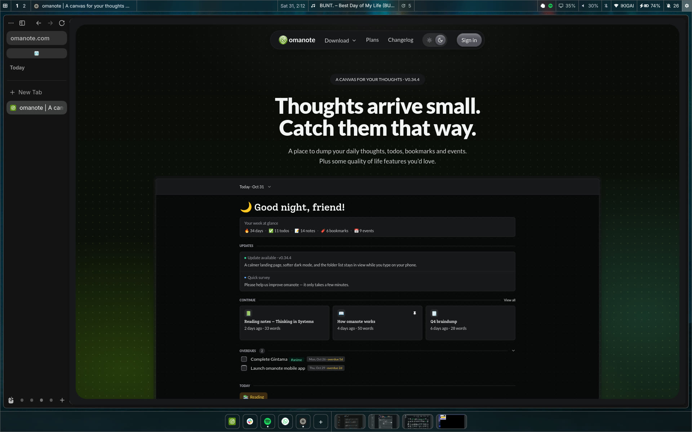
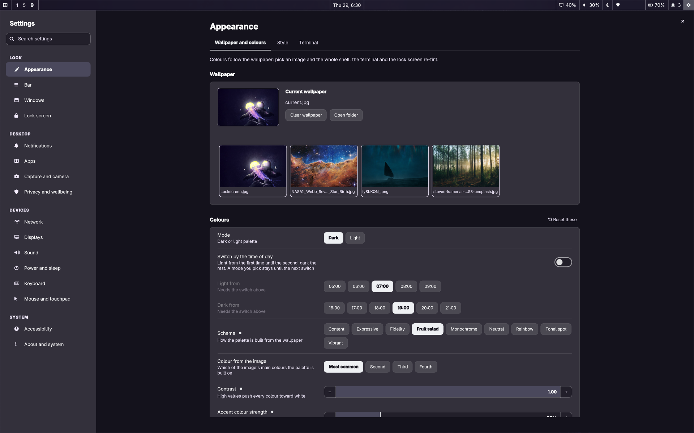
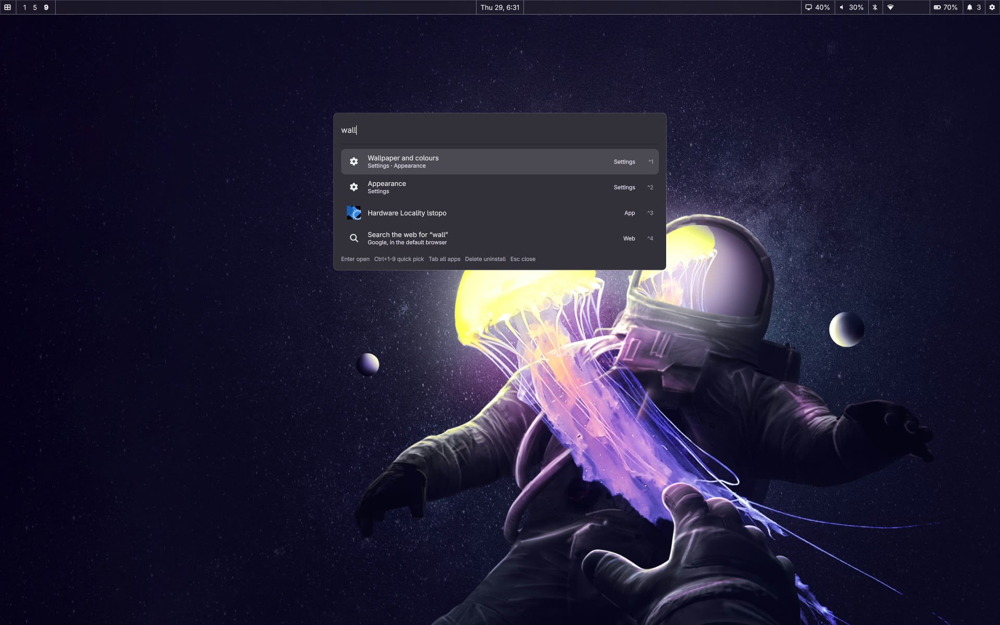
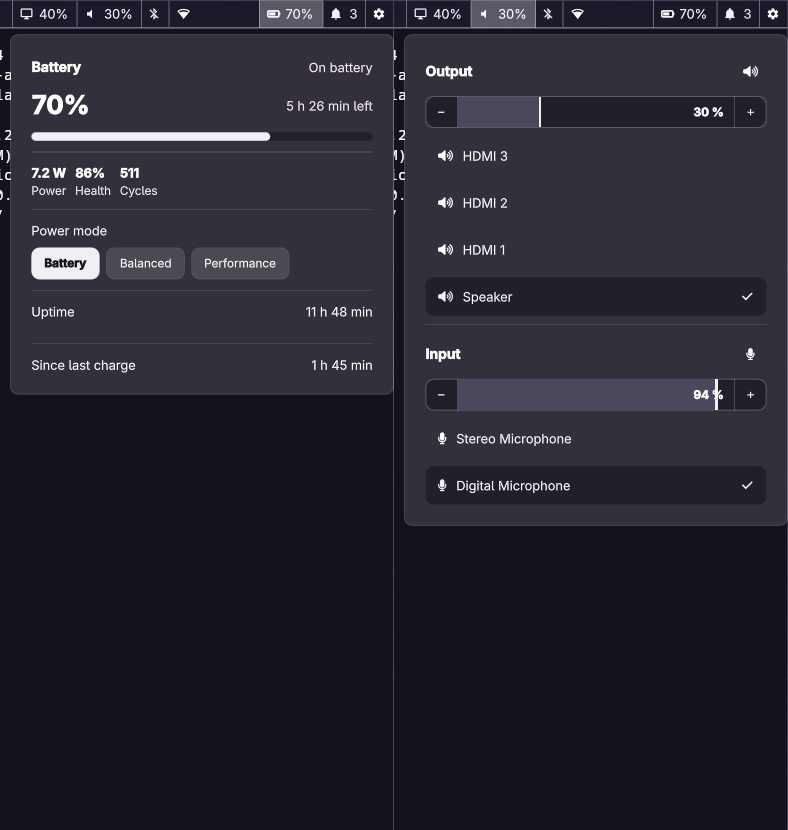
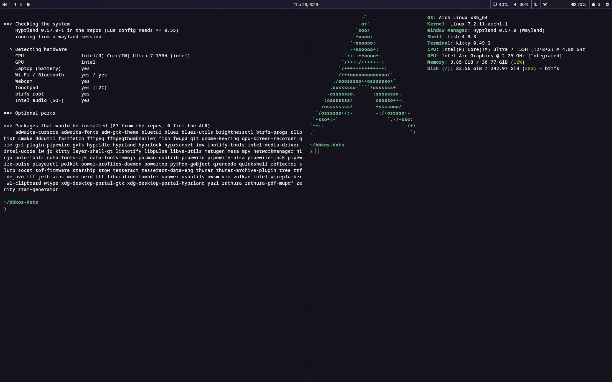
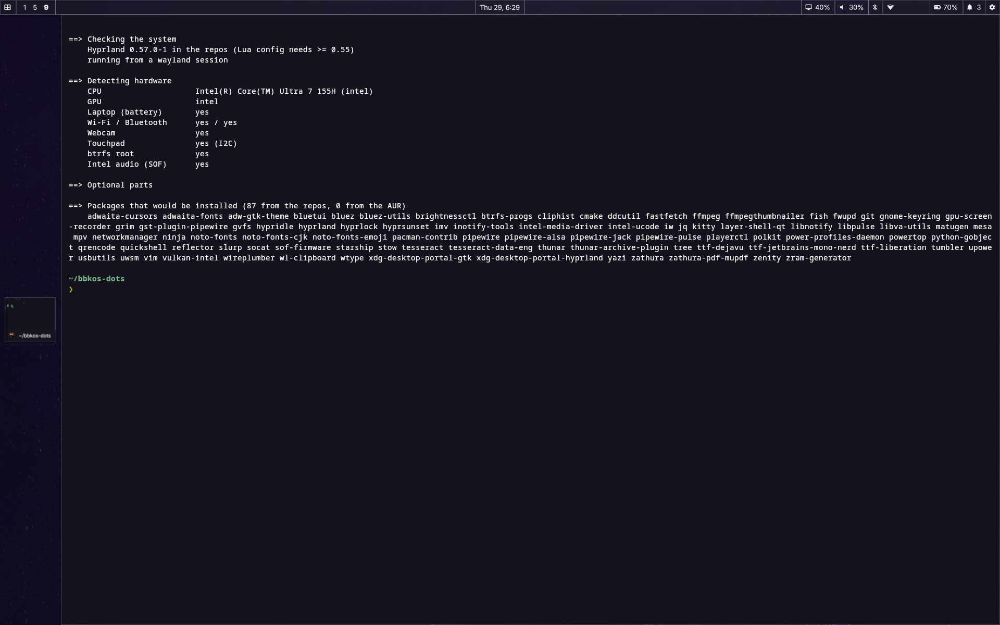

<div align="center">

# bbkOS dots

**A wallpaper-themed Hyprland + Quickshell desktop for Arch Linux.**
One installer that looks at your hardware, a settings app, an agent skill, and an uninstaller that puts everything back.



</div>

Colours come from the wallpaper. Every look and behaviour setting (bar, gaps, radii, blur, fonts, lock screen, keybinds, touchpad, power) is one value in one JSON file, edited from a settings window or the `bbkos-theme` command. Built on Hyprland's new **Lua config** (0.55+), Quickshell, matugen and uwsm.

| | |
|---|---|
|  **Settings app** (`Super+,`): 16 pages, search, reset per page |  **Launcher** (`Super+R`): apps, commands and every single setting |
|  **Bar popups**: battery, sound, calendar, Wi-Fi, Bluetooth, display, timer |  **Tiling**, kitty, fish, starship |

## What is in it

- **Shell:** bar, launcher, notifications, lock screen (hyprlock), OSDs, clipboard history with preview, emoji picker, screen recorder, webcam controls, calendar and timer. All QML in `dotfiles/quickshell`.
- **Theme engine:** `bbkos-theme` turns the wallpaper into colours for the shell, kitty, GTK 3/4, hyprlock and Hyprland; every text colour is lifted until it passes WCAG contrast on the surface it is drawn on.
- **Window management:** workspace overview (three-finger swipe), optional *stage mode* (one window at a time with a rail of cards), grid mode, per-monitor scale and layout, DDC/CI brightness for external monitors.
- **Laptop:** battery and power-profile popups, lid actions, optional root helpers for power limits, charge mode and a touchpad stall fix.
- **Extras (opt in):** local dictation (Voxtype), Android app manager, screen sharing over VNC, btrfs snapshots.
- **Agent skill:** `.claude/skills/bbkos` plus `AGENTS.md`, so Claude Code (or any agent) can change the desktop without breaking it. See [Using an agent](#using-an-agent).

## Install

Requirements: Arch Linux (or a derivative with the same repos), a normal user with `sudo`, and **Hyprland 0.55 or newer** (the config is Lua; the installer refuses to continue otherwise). Works best on a fresh install with a Wayland session you can log into from a TTY or display manager.

```sh
sudo pacman -S --needed git stow
git clone https://github.com/thehumanx/bbkos-dots.git
cd bbkos-dots
./install.sh --detect      # what it found, and the packages it would install. Changes nothing.
./install.sh               # asks a few questions, then does it
```



Keep the checkout where it is: the config files are symlinks into it.

### What the installer does

1. **Detects hardware** (see below) and builds a package list from `packages/*.txt`. Official repos only unless you opt in to dictation. Packages already installed are not touched.
2. Runs `sudo pacman -S --needed …` once, showing the list. Nothing is installed silently.
3. **Moves any file in the way** to `~/.local/share/bbkos/backup/<time>/`, then links the dotfiles with Stow. Nothing is overwritten.
4. Renders the two files that hold absolute paths (`hyprlock.conf`, `gtk-4.0/gtk.css`), copies `defaults/settings.json` to `~/.config/bbkos/` if you have none, sets the default wallpaper and generates the theme.
5. Enables the user services (`quickshell`, `cliphist`, `hypridle`, `bbkos-camera`), and asks before enabling `NetworkManager`, `bluetooth` and `power-profiles-daemon` or installing root helpers.
6. Builds [omasnap](https://github.com/omacom/omasnap) (screenshots, OCR, annotation) from source at a pinned commit.

### Hardware detection

| Detected | Installed |
|---|---|
| CPU Intel / AMD | `intel-ucode` / `amd-ucode` |
| GPU Intel / AMD / NVIDIA | `mesa` + `vulkan-intel` + `intel-media-driver` / `vulkan-radeon` / `nvidia-open-dkms` + `nvidia-utils` (older NVIDIA cards: edit `packages/hw-nvidia-gpu.txt`) |
| Intel HD audio controller | `sof-firmware` |
| Battery (laptop) | `powertop`; offers the power and lid helpers and `power-profiles-daemon` |
| No Bluetooth / no Wi-Fi | drops `bluez*`, `bluetui` / `iw` |
| I2C touchpad | offers the touchpad stall fix |
| btrfs root | `btrfs-progs`; offers snapper snapshots |
| Intel Core Ultra (Meteor Lake and newer) | offers `intel-lpmd` |
| `tlp` or `auto-cpufreq` enabled | skips `power-profiles-daemon` (they conflict) |
| `iwd` or `systemd-networkd` running | leaves your network stack alone (the Wi-Fi panel needs NetworkManager) |

### Options

```
./install.sh [--detect] [--dry-run] [-y] [--with LIST] [--no-extras] [--no-packages]
             [--no-omasnap] [--no-services] [--no-system]
--with   dictation,android,remote,snapshots,lpmd,touchpad,all
```

`--dry-run` runs every step and prints the `sudo` commands instead of running them. `--no-system` touches nothing outside `$HOME` except `pacman`.

### First login

No display manager is configured for you. From a TTY, after logging in:

```sh
uwsm start hyprland-uwsm.desktop
```

(or pick *Hyprland (uwsm-managed)* in your display manager; `docs/modules/session.md` shows a greetd autologin setup). Then `Super+,` for the settings and `bbkos-check` for a health check.

## Keys

| | |
|---|---|
| **Apps** | `Super+Q` terminal · `Super+E` files · `Super+R` launcher · `Super+,` settings · `Super+L` system menu |
| **Windows** | `Super+C` close · `Super+V` float · `Super+F` fullscreen · `Alt+Tab` cycle · `Super+Alt+S` stage mode |
| **Workspaces** | `Super+1…0` go to · `Super+Shift+1…0` move the window there · `Super+S` scratch workspace |
| **Capture** | `Super+Shift+S` screenshot · `Super+Shift+T` copy text from the screen (OCR) · `Super+Shift+R` record menu |
| **Tools** | `Super+Ctrl+V` clipboard history · `Super+;` emoji · `Super+Ctrl+X` dictation (opt-in) |
| **Session** | `Super+Ctrl+L` lock · `Super+Shift+Space` hide the bar |

All of them are editable in Settings > Keyboard > Shortcuts, or `bbkos-keybinds`.

## Customise

| Do this | With |
|---|---|
| Look: colours, bar, gaps, radii, blur, fonts, lock screen | `Super+,` or `bbkos-theme set shell.barHeight 36` · `bbkos-theme status` |
| Wallpaper (colours follow it) | Settings > Appearance, `bbkos-theme wallpaper set FILE`, or right-click an image in Thunar |
| Keybindings | `bbkos-keybinds` (never edit the generated file) |
| Monitors | `bbkos-display` or the Display popup |
| Anything Hyprland-specific | `~/.config/hypr/hyprland.lua` is a symlink into this repo: edit it there, keep your changes on a branch |
| Go back to defaults | `bbkos-theme reset` (everything) or `reset SECTION` |

Your settings live in `~/.config/bbkos/settings.json`, a copy that the settings app writes to. `git pull` never touches it.

## Update

```sh
git pull && ./install.sh --no-packages    # re-link, re-render, regenerate the theme
```

## Uninstall

```sh
./uninstall.sh                # unlink, remove rendered files, disable user services, restore the files it moved aside
./uninstall.sh --system       # also remove the root helpers and the system services it enabled
./uninstall.sh --packages     # also pacman -Rns the packages install.sh added (not those you already had)
./uninstall.sh --purge        # also delete ~/.config/bbkos, ~/.local/state/bbkos and the backups
```

`--dry-run` shows what would happen. Your own settings stay unless you pass `--purge`.

## Using an agent

The repo ships an agent skill. In Claude Code it loads on its own when you work here: ask *"make the bar taller"*, *"add a shortcut for X"* or *"the touchpad stopped working"* and it uses the right tool (`bbkos-theme`, `bbkos-keybinds`, `bbkos-touchpad-reset`). It encodes the rules that were learned the hard way: never run `sudo` for you, read the live state before fixing, Hyprland config is Lua (not `hyprland.conf`), check the screen is unlocked before touching the session, settings only through the tool. Every `bbkos-*` command and its doc is indexed in `.claude/skills/bbkos/modules-index.md`.

Other agents (Codex, opencode, Gemini CLI, Cursor, …): they read `AGENTS.md`, which points at the same skill; copy `.claude/skills/bbkos/` to where yours looks for skills if it has such a folder. `Super+Ctrl+Enter` opens a terminal running `claude` in the checkout (install Claude Code first: not part of the installer).

## Layout

```
install.sh  uninstall.sh  lib.sh    detection, packages, stow, backups
packages/                           core, extras, optional-*, hw-* lists (plain text, one package per line)
dotfiles/                           Stow packages (see dotfiles/README.md)
templates/  defaults/  assets/      rendered files, shipped look, wallpaper and screenshots
scripts/  power/  touchpad/         root helpers (each has --uninstall), omasnap and dictation installers
docs/modules/                       one doc per component: what it is, where its config lives, how to undo it
tests/                              python3 -m unittest discover -s tests/<area>
.claude/skills/bbkos/  AGENTS.md    the agent skill
```

## Status and honesty

- Built and used daily on **one laptop** (Lenovo Slim 7, Intel Core Ultra 7, Arc iGPU, btrfs). Intel is the tested path. The AMD and NVIDIA package sets, the no-battery (desktop) path and non-btrfs installs are written from the Arch wiki and **untested on real hardware**.
- What was verified for this repo: hardware detection and the package list on the author's machine, every package name against the Arch repos, link, render, backup and uninstall in a throwaway `$HOME` with a pre-existing config planted, the theme engine from an empty `$HOME`, and the test suites (theme, keybinds, power, touchpad, launcher, dictation, android, skill). **Not verified:** a full install on a fresh machine with a real package install and first login.
- `docs/modules/` are the author's working notes, written in the first person of one owner's machine. They are accurate about how things work; measurements and some paths are the author's.

## Credits

[Hyprland](https://hypr.land) and the hypr* tools · [Quickshell](https://quickshell.org) · [matugen](https://github.com/InioX/matugen) · [uwsm](https://github.com/Vladimir-csp/uwsm) · [omasnap](https://github.com/omacom/omasnap) from the Omarchy project · ideas from [end-4/dots-hyprland](https://github.com/end-4/dots-hyprland), [Caelestia](https://github.com/caelestia-dots/caelestia) and [Omarchy](https://github.com/basecamp/omarchy).

MIT, see [LICENSE](LICENSE). The wallpaper is not covered, see [NOTICE](NOTICE).
